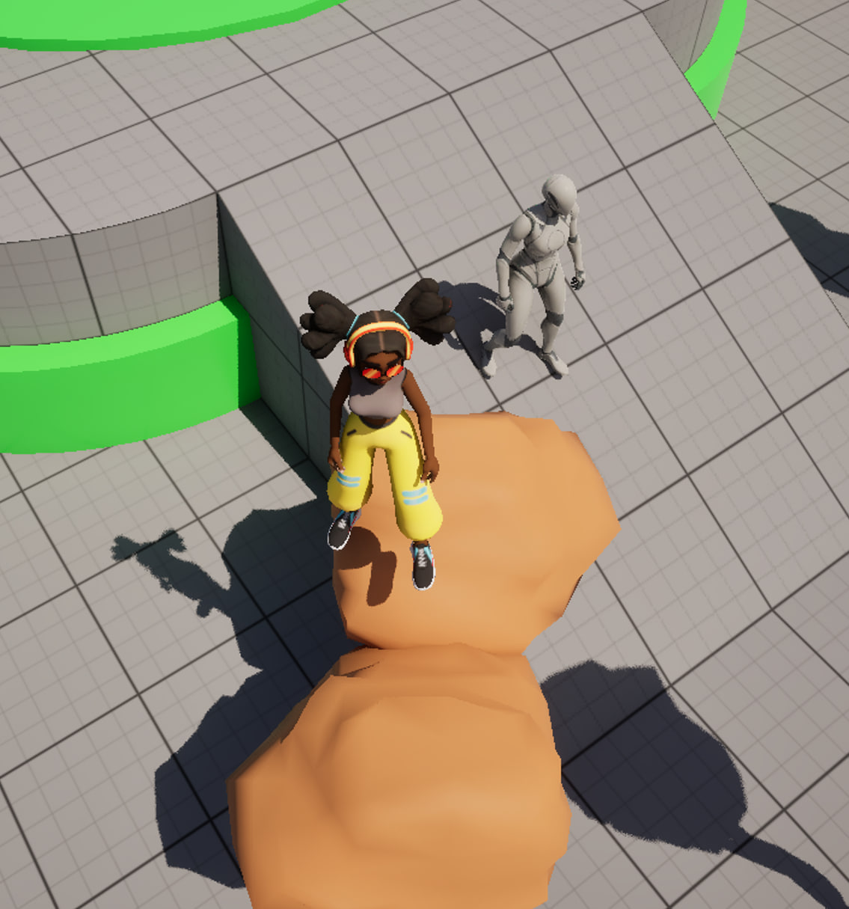

# Домашнее задание по курсу Unreal Engine

Выполнила Ванеева Наталья Михайловна, БПИ243.

1. [Расширение Third Person Template](#домашнее-задание-1-расширение-third-person-template)

2. [Behavior Trees и PCG](#домашнее-задание-2-behavior-trees-и-pcg)

3. [Управление](#управление)

## Домашнее задание 1: Расширение Third Person Template 

### Реализовано

- C++-класс MyCharacter, унаследованный от ACharacter
- BP_ThirdPersonCharacter наследуется от MyCharacter
- Спринт и взаимодействие через Enhanced Input
- Dynamic Multicast Delegate OnInteract и обработка события в Blueprint
- Состояние Sprint в Animation Blueprint и переходы по bIsSprinting
- Выносливость: расход при спринте в движении, восстановление
  и остановка спринта при исчерпании
- Вывод выносливости на экран
- В рамках самодеятельности: персонаж из Mixamo с перенесёнными анимациями

## Домашнее задание 2: Behavior Trees и PCG

### Левел-дизайн и процедурная генерация

- Добавлен NavMeshBoundsVolume для работы навигации. В настройках проекта включена Runtime Generation (Dynamic) для корректного огибания объектов
- Создан PCG-граф PCG_ForestGen для генерации леса
- Использован тег PCG_Floor для поиска поверхности пола узлом Get Actor Data
- Для фильтрации пола от других спавна и стен (там деревья не нужны) использован узел World Ray Hit Query
- Настроена генерация: Surface Sampler создает точки, узел Transform Points задает случайный поворот объектам, Static Mesh Spawner размещает модели деревьев и камней с коллизией BlockAllDynamic
- С помощью узла Difference (Binary) реализовано вычитание зон. Узлы Get Actor Data (с тегами PCG_Spawn и PCG_Wall) собирают данные о стенах и спавне, и деревья не появляются в этих местах

### Настройка ИИ и C++ классы

- Создан C++ класс AEnemyCharacter, настроены параметры гравитации и движения для корректного спавна
- Создан C++ класс AEnemyAIController
- Настроено зрение: в контроллере добавлены компоненты AIPerceptionComponent и AISenseConfig_Sight. Настроена реакция на игрока
- При обнаружении игрока контроллер записывает его в TargetActor и ставит флаг CanSeePlayer = true на Blackboard

### Поведение ИИ

- Создан BB_Enemy (Blackboard) с ключами: TargetActor, PatrolLocation, CanSeePlayer, HomeLocation
- Создан кастомный узел дерева поведения на C++ (BTTask_FindRandomPatrolPoint), который использует UNavigationSystemV1 для поиска случайной достижимой точки в радиусе вокруг старта
- Создан BT_Enemy (Behavior Tree) с возможностями:
  - Патрулирование
  - Преследование: Если ИИ видит игрока в поле зрения, он фокусируется на игроке и бежит к нему.
  - При потере игрока из виду ИИ возвращается к патрулированию

## Управление

- WASD/стрелочки: движение
- Мышь: управление камерой
- Пробел: прыжок
- Shift: спринт
- E: взаимодействие (вывод сообщения "Interaction triggered!")

## Баги и фичи

В ходе тестирования был выявлен баг:

Если игрок запрыгнет со спавна на дерево, ИИ не сможет его достать.

